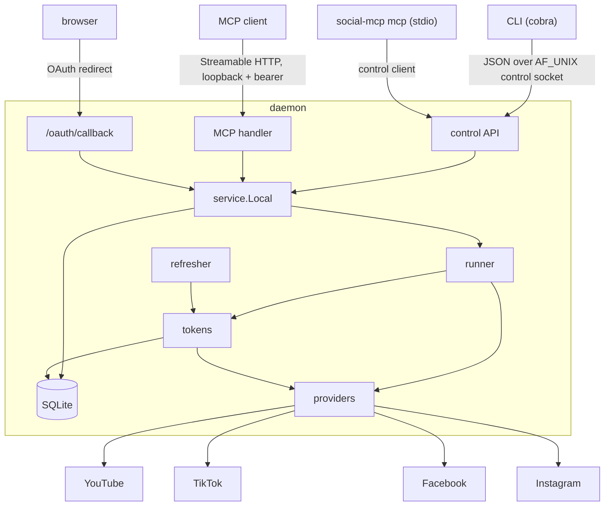

# Architecture

## Components

Each package does one job:

- **`internal/service`:** one `Service` interface backs the control API, the MCP tools in the daemon, and
  stdio MCP mode (through `control.Client`), so the tools are written once.
- **`internal/provider`:** the platform contract. The `youtube`, `tiktok`, `facebook` and `instagram`
  packages implement it, with `meta` shared by the last two. `internal/daemon/providers.go` is the only file
  that imports platform packages.
- **`internal/runner`:** claims queued jobs, uploads with retries, and records results.
- **`internal/tokens`:** refreshes tokens with a lock per credential and compare-and-swap writes.
- **`internal/refresher`:** refreshes tokens that are about to expire.
- **`internal/daemon`:** process lock, listeners, startup and shutdown order, and detaching from the terminal.

## Storage and encryption

Everything lives in the home directory (`SOCIAL_MCP_HOME`, or your user config directory plus
`social-mcp`):

| File | Purpose |
|---|---|
| `config.toml` | Settings and platform app credentials |
| `social-mcp.db` | SQLite: credentials, accounts, upload jobs, metadata |
| `master.key` | Encryption key, only when the OS keyring is not used |
| `mcp-token` | Bearer token for the MCP endpoint |
| `daemon.lock`, `daemon.pid`, `daemon.sock`, `daemon.log` | Daemon runtime files |
| `backups/` | Copies of the database (`VACUUM INTO`) taken before schema migrations, newest 5 kept |

How it works:

- **Encryption:** tokens are sealed with AES-256-GCM.
- **Key storage:** the database records which backend holds the key, plus a sealed check value. A new key is
  only created for a home with no sealed data, so a briefly unavailable keyring can never split tokens
  across two keys. The keyring entry name includes a hash of the home path.
- **Credentials and accounts:** a *credential* is one login, identified by platform and subject: a YouTube
  channel ID, a TikTok `open_id`, or a Facebook user ID. An *account* is one place to publish (a channel,
  TikTok user, Page or Instagram account) and points to its credential. Facebook Pages also carry their own
  Page token.
- **Account health:**
  - `needs_reauth` when the account, or the credential it depends on, is flagged.
  - Otherwise it depends on a deadline: the account token's expiry when the account has its own token,
    otherwise the credential's refresh-token expiry (refreshable logins) or token expiry (others).
  - `expiring` within 7 days of that deadline.
- **Database writes:** a single writer connection with immediate transactions, so concurrent writers wait
  instead of failing.

## Upload lifecycle

1. **Submit:** `upload_video` validates the file (absolute path, optional `allowed_dirs`, video container
   detection) and each account (health, privacy, format, size, options, metadata). It creates one job per
   accepted account, recording the file's size, modification time and fingerprint.
2. **Run:** workers claim jobs atomically. TikTok and Instagram run one job per account at a time. Each
   attempt re-checks that the file is unchanged and reads it through the opened handle.
3. **Phases:**
   - `pending`: queued, nothing sent yet.
   - `transferring`: bytes are being sent; nothing is published yet, so a retry can start over.
   - `committing`: the next call could publish.
   - `processing`: the platform is still working on it.
   - `done`: finished.

   Providers record a change of phase before the next step. Once a job reaches `committing`, every later
   attempt reconciles with the platform instead of repeating a call that could publish:
   - YouTube asks the upload session for its status.
   - TikTok checks the publish status.
   - Facebook looks the video up.
   - Instagram reads the container status.
4. **Outcomes:**
   - **Network or server errors:** retried up to 3 times with backoff.
   - **Rate limits:** retried after the delay the platform asks for, without using up an attempt.
   - **Permanent errors (quota, policy, validation):** fail immediately.
   - **Rejected token:** refreshed once when possible. Otherwise the owner (the account for Page tokens, the
     credential for the rest) is marked `needs_reauth`.
   - **Unknown result:** when a publish result cannot be determined, the job becomes `needs_review`.
5. **Cancel and shutdown:**
   - A user cancel stops a job only before `committing`.
   - Shutdown interrupts uploads without changing their status, so the next daemon start resumes them from
     the recorded phase.

## Daemon lifecycle

- **Start:** the daemon takes an exclusive lock on `daemon.lock`, then binds the control socket and the
  loopback port. If the port is taken it exits with an error naming the port; it never picks another one.
  Only after that does it open the database and start the runner, so a failed start changes no job.
- **Detach:** `daemon start` launches `daemon run --detached` in its own session. On Windows it starts
  detached and breaks away from the terminal's job when allowed.
- **Stop:** `daemon stop` asks the daemon to shut down, then waits for the lock to be released before
  reporting that it stopped.
- **Long paths:** when `home/daemon.sock` would exceed the AF_UNIX path limit, the socket goes in the system
  temp directory under a name derived from the home path.
