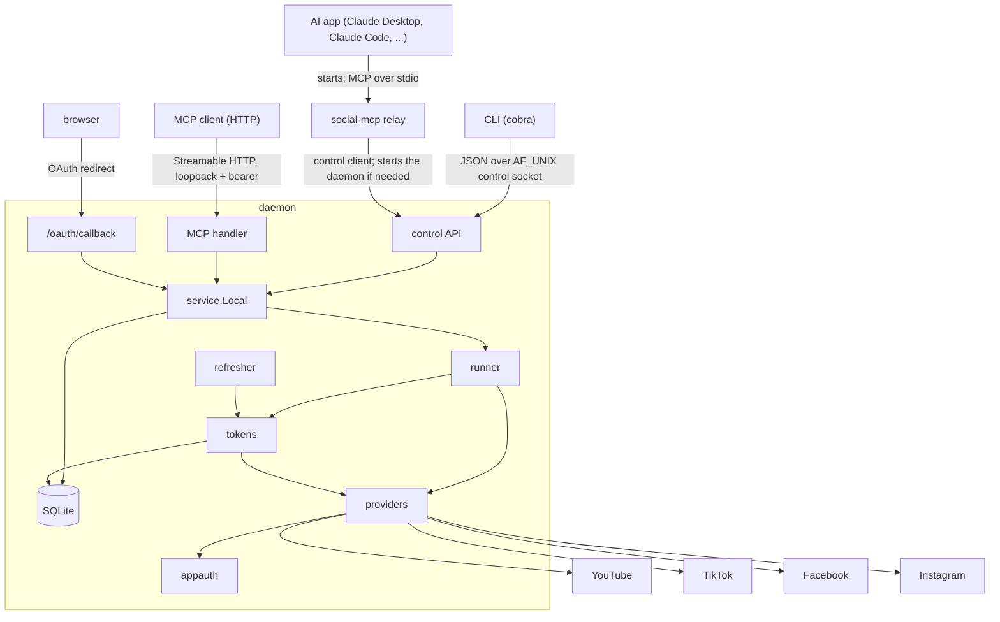

# Architecture

## Components

Each package does one job:

- **`internal/service`:** one `Service` interface backs the control API, the MCP tools in the daemon, and
  the relay (through `control.Client`), so the tools are written once.
- **`internal/cli/relay.go` (`social-mcp relay`, hidden from help):** the command every `connect` entry
  starts. It serves the MCP tools over stdio and forwards each call to the daemon. Its `control.Client` uses
  `AutoStart`: when nothing answers on the socket it starts the daemon (`daemon.Start`) and retries the
  request once. A failed dial means the request never reached the daemon, so the retry cannot submit an
  upload twice. This is what lets an app be connected once whether or not the daemon is running.
- **`internal/cli/connect.go`, `settings.go` and `internal/wsl`:** `connect` holds one entry per supported
  app (where its settings live, how to write them, and what the user does next). JSON settings (Claude
  Desktop, Cursor, Antigravity) are edited key-order-preserving and Codex's TOML by replacing only the
  `[mcp_servers.social-mcp]` table, each after a timestamped backup; Claude Code goes through `claude mcp add`.
  Inside WSL the desktop apps' settings are found in the Windows profile and their entry runs
  `wsl.exe -d <distro> -- <exe> relay`, and `SubmitUpload` converts Windows paths with `wslpath`.
- **`internal/appauth`:** the OAuth app identity per platform (embedded in release builds, or `SOCIAL_MCP_*`
  overrides) and the only code that uses app secrets: `TokenEndpoint` performs code exchanges, refreshes and
  Meta's long-lived swap, so a hosted broker could replace it without changing the providers.
- **`internal/provider`:** the platform contract. The `youtube`, `tiktok`, `facebook` and `instagram`
  packages implement it, with `meta` shared by the last two. `internal/daemon/providers.go` is the only file
  that imports platform packages.
- **`internal/runner`:** claims queued jobs, uploads with retries, and records results.
- **`internal/tokens`:** refreshes tokens with a lock per credential and compare-and-swap writes.
- **`internal/refresher`:** refreshes tokens that are about to expire.
- **`internal/daemon`:** process lock, listeners, startup and shutdown order, and detaching from the terminal.

## Storage and encryption

Everything lives in the home directory (`SOCIAL_MCP_HOME`, or your user config directory plus
`social-mcp`):

| File | Purpose |
|---|---|
| `config.toml` | Upload and update-check settings |
| `social-mcp.db` | SQLite: credentials, accounts, upload jobs, metadata |
| `master.key` | Encryption key, only when the OS keyring is not used |
| `mcp-token` | Bearer token for the MCP endpoint |
| `daemon.lock`, `daemon.pid`, `daemon.sock`, `daemon.log` | Daemon runtime files |
| `update-check.json` | Latest release found by the daemon's daily check, and the release the agent was last told about |
| `update-notice-cli` | The release the CLI last announced |
| `backups/` | Copies of the database (`VACUUM INTO`) taken before schema migrations, newest 5 kept |

How it works:

- **Encryption:** tokens are sealed with AES-256-GCM.
- **Key storage:** the database records which backend holds the key, plus a sealed check value. A new key is
  only created for a home with no sealed data, so a briefly unavailable keyring can never split tokens
  across two keys. The keyring entry name includes a hash of the home path.
- **Credentials and accounts:** a *credential* is one login, identified by platform and subject: a YouTube
  channel ID, a TikTok `open_id`, or a Facebook user ID. An *account* is one place to publish (a channel,
  TikTok user, Page or Instagram account) and points to its credential. Facebook Pages also carry their own
  Page token.
- **Issuing app:** each credential records the client ID of the OAuth app that issued it. At startup the
  daemon flags credentials from any other app, and their accounts, as `needs_reauth`, because the current app
  cannot refresh or use those tokens.
- **Account health:**
  - `needs_reauth` when the account, or the credential it depends on, is flagged.
  - Otherwise it depends on a deadline: the account token's expiry when the account has its own token,
    otherwise the credential's refresh-token expiry (refreshable logins) or token expiry (others).
  - `expiring` within 7 days of that deadline.
- **Database writes:** a single writer connection with immediate transactions, so concurrent writers wait
  instead of failing.

## Upload lifecycle

1. **Submit:** `upload_video` validates the file (absolute path, optional `allowed_dirs`, video container
   detection; inside WSL a Windows path such as `C:\Videos\a.mp4` is first converted with `wslpath`) and each account (health, privacy, format, size, options, metadata). It creates one job per
   accepted account, recording the file's size, modification time and fingerprint.
2. **Run:** `uploads.max_concurrent` workers (default 2, at most 16) claim jobs atomically. TikTok and
   Instagram run one job per account at a time. Each attempt re-checks that the file is unchanged and reads it
   through the opened handle.
3. **Phases:**
   - `pending`: queued, nothing sent yet.
   - `transferring`: bytes are being sent; nothing is published yet, so a retry can start over.
   - `committing`: the next call could publish.
   - `processing`: the platform is still working on it.
   - `done`: finished.

   Providers record a change of phase before the next step. Once a job reaches `committing`, every later
   attempt reconciles with the platform instead of repeating a call that could publish:
   - YouTube asks the upload session for its status.
   - TikTok checks the publish status.
   - Facebook looks the video up.
   - Instagram reads the container status.
4. **Outcomes:**
   - **Network or server errors:** up to 3 attempts in total, with increasing backoff between them.
   - **Rate limits:** retried after the delay the platform asks for, without using up an attempt. A job that is
     still rate limited 24 hours after its first rate limit fails.
   - **Permanent errors (quota, policy, validation):** fail immediately.
   - **Rejected token:** refreshed once when possible. Otherwise the owner (the account for Page tokens, the
     credential for the rest) is marked `needs_reauth`.
   - **Unknown result:** when a publish result cannot be determined, the job becomes `needs_review`.
   - **After `committing`:** a job that would fail once it has reached `committing` becomes `needs_review`
     instead, because the publish step may have taken effect; it is never reported as safe to upload again.
5. **Cancel and shutdown:**
   - A user cancel stops a job only before `committing`.
   - Shutdown interrupts uploads without changing their status, so the next daemon start resumes them from
     the recorded phase.

## Daemon lifecycle

- **Start:** the daemon takes an exclusive lock on `daemon.lock`, then binds the control socket and the
  loopback port. If the port is taken it exits with an error naming the port; it never picks another one.
  Only after that does it open the database and start the runner, so a failed start changes no job.
- **Detach:** `daemon start` launches `daemon run --detached` in its own session. The relay starts the daemon
  the same way when nothing answers on the control socket. On Windows it starts
  detached and breaks away from the terminal's job when allowed.
- **Stop:** `daemon stop` asks the daemon to shut down, then waits for the lock to be released before
  reporting that it stopped.
- **Long paths:** when `home/daemon.sock` would exceed the AF_UNIX path limit, the socket goes in a per-user
  folder under the system temp directory (`social-mcp-<uid>` with mode `0700` on Unix, `social-mcp-<hash of SID>` on
  Windows), named after a hash of the home path. On Unix the CLI checks that the socket belongs to the current
  user before using it.
- **Status:** `daemon status` checks the process lock as well as the socket, so a daemon whose socket was
  removed is reported as running but unreachable (exit code 4), not as stopped. `daemon stop` then terminates
  it directly, escalating to a hard kill if the process ignores the termination signal.
- **Logs:** `daemon.log` is rotated to `daemon.log.1` at startup once it exceeds 10 MB.
- **Update check:** a release build of the daemon looks up the latest stable release at most once a day,
  through the `releases/latest` redirect the installers use (no GitHub API). The CLI and the agent's
  `list_accounts` each mention a newer release once. Development builds, `[updates] check = false` and
  `SOCIAL_MCP_NO_UPDATE_CHECK` turn it off. Each state file has one writer: the daemon owns
  `update-check.json`, the CLI owns `update-notice-cli`.
- **Self-update:** `social-mcp update` verifies the new binary against `SHA256SUMS` and checks that it reports
  the expected version before it stops the daemon and swaps the file, so a failed download changes nothing.
  The daemon is restarted through the new file's path. On Windows the running `.exe` is renamed to
  `.exe.old`, which is removed on the next update or daemon start.
