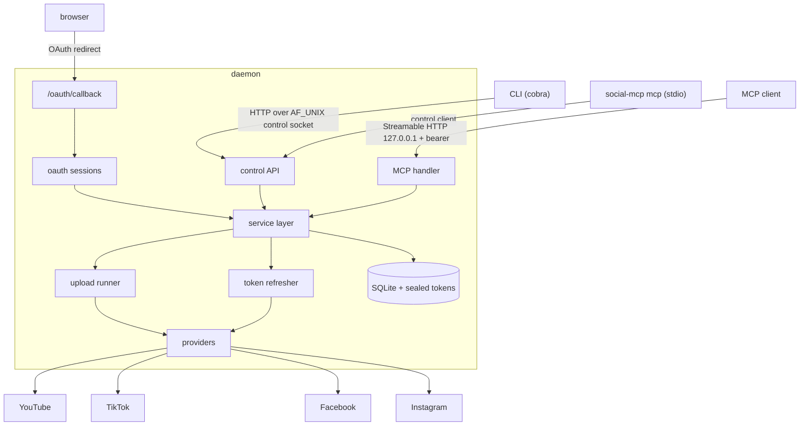

# social-mcp v1

## Overview

Single Go binary that runs as a CLI-managed daemon, stores OAuth credentials for
multiple accounts per platform, and exposes MCP tools for uploading local videos to
YouTube, TikTok (drafts), Facebook Pages and Instagram Reels.

Source contract: [brainstorm report](../reports/brainstorm-261102-1411-social-media-mcp-server.md)
(outcome, constraints, non-goals, verified blocker check, decisions). This plan does
not restate it; it turns it into executable phases.

All paths below are relative to the repository root (where `go.mod` lives).
Go module: `github.com/nhatnam1507/social-mcp`. Go 1.26.

## Locked decisions

- Platforms: YouTube (direct), TikTok (**upload to inbox / drafts only**, `video.upload`),
  Facebook Pages (Page `/videos` chunked upload with a never-expiring Page token),
  Instagram Reels (resumable `rupload` with Facebook Login for Business user token).
- Bring-your-own developer apps; credentials live only in local config.
- Targets: linux, darwin, windows × amd64, arm64; `CGO_ENABLED=0`.
- Video source: any local file path the user gives; `allowed_dirs` is optional (empty = no
  directory restriction). Files must pass the video container check and must not change
  between submit and upload.
- Agents cannot add or remove accounts; the CLI is the only path.
- Approval for uploads (including public posts) is the MCP client's tool-permission prompt;
  `upload_video` is annotated destructive/open-world so clients do not auto-approve it. No
  server-side approval queue.
- Privacy defaults to `private`. A platform that cannot honor the requested privacy
  rejects that account instead of silently publishing more widely (Instagram has no
  private Reels, so it requires explicit `public`).
- No step that publishes (final chunk, finish, media_publish, TikTok init after upload) is ever
  repeated after it may have happened; unknown outcomes become `needs_review`.
- Meta login uses the loopback `http://localhost` redirect only (Live-mode acceptance unverified).
- The user chose to build all four providers now; the Meta and TikTok live probes from the
  brainstorm are human follow-ups, not blocking gates. Code is contract-tested against the
  documented APIs.

## Architecture

One `service.Service` interface backs the control API, the MCP tools in the daemon, and
the stdio MCP mode (through a control-socket client). MCP tool code is written once.

## Phases

| # | Phase | Status |
|---|-------|--------|
| 1 | [Foundation: module, config, paths, secrets, store](./phase-01-foundation.md) | Completed |
| 2 | [Core engine: provider contract, OAuth, file guard, runner, refresher](./phase-02-core-engine.md) | Completed |
| 3 | [Daemon and CLI](./phase-03-daemon-and-cli.md) | Completed |
| 4 | [MCP server](./phase-04-mcp-server.md) | Completed |
| 5 | [YouTube provider](./phase-05-youtube-provider.md) | Completed |
| 6 | [TikTok provider (inbox)](./phase-06-tiktok-provider.md) | Completed |
| 7 | [Meta providers: Facebook Pages, Instagram Reels](./phase-07-meta-providers.md) | Completed |
| 8 | [CI, packaging, end-to-end test, docs](./phase-08-ci-packaging-docs.md) | Completed |

Dependencies: 1 → 2 → 3 → 4. Phases 5, 6, 7 depend on 2 and 3; their packages are
disjoint, but each adds one registration line to `internal/daemon/providers.go`, so those
edits are serialized. 8 depends on all.

## Test strategy (TDD)

- Every phase writes failing tests first, then code. `go test ./...` must pass at the end
  of each phase; `go vet ./...` clean.
- Providers are contract-tested against `httptest` servers that enforce the documented
  request shapes (headers, ranges, params) and return documented responses. Base URLs
  are struct fields set by tests; no test hooks in user config.
- Daemon lifecycle and the MCP path are covered by an end-to-end test that builds the
  binary, starts it with a temp `SOCIAL_MCP_HOME`, and drives it with the CLI and an
  MCP client (phase 8). CI runs the suite on Linux, macOS and Windows.
- No test may pass by skipping assertions; network calls to real platforms are never made
  in tests.

## Success Criteria

- [ ] Brainstorm acceptance criteria 1–6 hold, with the TikTok adjustment (drafts end in
      `sent_to_drafts`, no post URL).
- [ ] `go test ./...` and `go vet ./...` pass on Linux, macOS, Windows in CI.
- [ ] `scripts/build-all.sh` produces six static binaries.
- [ ] `list_accounts` reports per-account restrictions (`draft_only`, `no_private_option`,
      `visible_to_app_roles_only`) and health.
- [ ] README and `docs/platform-setup.md` explain app registration, redirect URIs,
      config, MCP client setup and platform limits.

## Human follow-ups (outside this plan)

- Meta probe: Live-mode post visibility, Live-mode acceptance of the `http://localhost`
  redirect, and the Page `/videos` `upload_phase` flow with a Page token.
- TikTok probe: inbox upload for a sandbox target user.
- Live end-to-end uploads with real developer apps on all four platforms.

## Red Team Review

### Session — 2026-11-02
**Findings:** 41 raw from 4 reviewers, deduplicated to 15 grouped findings plus folded items
(15 accepted, 2 folded items rejected).
**Severity breakdown:** 5 Critical, 9 High, 1 Medium (grouped).

| # | Finding | Severity | Disposition | Applied To |
|---|---------|----------|-------------|------------|
| 1 | Provider registry import cycle; phases 5–7 share one file | Critical | Accept | Phases 2, 3, 5–7, plan |
| 2 | Single-instance race; listeners bound after runner start; stop trusts pidfile | Critical | Accept | Phase 3 |
| 3 | Retries/resume repeat publish steps (duplicate posts) | Critical | Accept | Phases 2, 5, 6, 7 |
| 4 | Keyring hiccup creates a second master key | Critical | Accept | Phase 1 |
| 5 | Meta localhost redirect may fail in Live mode; probe gates dropped | Critical | Accept (modified): bind `[::1]`, document risk; gates stay waived per user decision; manual fallback declined by user | Phases 3, 7, 8, plan |
| 6 | Health model inconsistent (Facebook Page tokens, single expiry column) | High | Accept | Phases 1, 2, 7 |
| 7 | Credential subject undefined; reauth can bind wrong account; remove with active jobs | High | Accept | Phases 1, 2, 3, 5–7 |
| 8 | Non-atomic job transitions; cancel vs shutdown | High | Accept | Phases 1, 2, 3 |
| 9 | Stale-token refresh, lost rotation, SQLite BUSY, WAL file copy | High | Accept | Phases 1, 2 |
| 10 | Secrets leak via stored errors | High | Accept | Phases 2, 3, 4, 7 |
| 11 | Agent can publish arbitrary allowed-dir files publicly | High | Accept (modified per user): client permission prompt + destructive annotation; content checks; optional allowed_dirs | Phases 2, 4, 8 |
| 12 | Untyped platform_options bypass privacy | High | Accept | Phases 2, 5, 7 |
| 13 | Token rotation can yield an empty bearer | High | Accept (simplified: no hot reload, fail closed) | Phases 3, 4 |
| 14 | Socket paths too long in macOS/Windows temp dirs | High | Accept | Phases 3, 8 |
| 15 | File validated once, read later; weak container sniff | Medium | Accept | Phase 2 |

Folded items accepted: stateless MCP HTTP and Host→Origin→bearer order (phase 4); Windows
breakaway detach and survival check (phases 3, 8); decimal TikTok chunk thresholds (phase 6);
explicit DTOs (phase 2); home ownership check and browser URL allowlist (phases 1, 3);
per-account serialization for TikTok/Instagram and rate limits not consuming attempts (phases
1, 2); remove YouTube `publish_at` (phase 5). Folded items rejected: platform-side token
revocation on `account remove` (not requested; documented instead); cutting the
pre-migration backup (required by the user's global rule; implemented with `VACUUM INTO`).
Meta PKCE: not added — unverified for Facebook Login for Business config flows; interception
risk mitigated by binding both loopback addresses plus single-use state.

### Whole-Plan Consistency Sweep
- Searched all plan files for superseded terms: `registry.go` modifications in provider phases,
  `allowed dir` defaults, `publish_at`, `mtime` hot reload, "disjoint packages", `ValidateMeta`
  result notes, and `restart the session` for Facebook. All updated; no stale copies remain.
- `service.Service` methods, DTO names, store API names (`TransitionUpload`, `ClaimNextUpload`,
  `UpdateCredentialToken`, `HasActiveUploads`) and provider methods (`Refreshable`, `Identities`
  returning subject, `Options`) match across phases 1–7.
- No unresolved contradictions.

## Validation Log

### Session 1 — 2026-11-02
Questions asked: 4 (combined with the red-team review prompt).

| Topic | Decision |
|---|---|
| Apply red-team dispositions | Apply accepted findings |
| Approval for public posts | Use the MCP client's tool-permission prompt (no server-side queue) |
| Meta login fallback | Loopback only |
| Upload source folder | Any path the user gives; server handles it; `allowed_dirs` optional |

Propagation: phases 1, 2, 3, 4, 7, 8 updated (markers in each file).

### Verification Results
- Claims checked: 44 (reviewers) + controller spot checks
- Verified: 36 | Failed: 0 | Unverified: 8
- Tier: Full
- Verified examples: go-sdk v1.8.0 has `NewStreamableHTTPHandler`, `StreamableHTTPOptions.Stateless`,
  `SessionTimeout`, localhost protection, `StreamableClientTransport`, `CommandTransport`, in-memory
  transports; go-keyring v0.2.8 exposes `ErrNotFound`; YouTube upload quota and unverified-project
  visibility; TikTok desktop hex PKCE and loopback redirect; TikTok chunk rules; Instagram rupload headers.
- Unverified (tracked as human follow-ups or risks): Meta Live-mode localhost redirect, Meta Live-mode
  visibility, Page `upload_phase` flow liveness, Instagram container status values, TikTok sandbox inbox,
  TikTok MB unit, `graph_version` default v26.0 (configurable), Facebook Login for Business loopback.

### Whole-Plan Consistency Sweep
- Searched for `allowed_dirs` defaults, approval states (`awaiting_approval`), and manual Meta login;
  none remain beyond the recorded decisions.
- Recommendation: proceed to implementation.

<!-- slug: social-mcp-v1 -->
